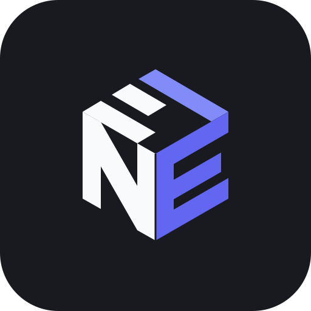

  
  <h1>NyeStudio</h1>
  
<strong>Dos desarrolladores construyendo software juntos</strong>

  
Nuestro espacio compartido para diseñar, programar y dar vida a ideas, herramientas y proyectos propios.

---

### Qué hacemos

En **NyeStudio** unimos fuerzas para desarrollar código a cuatro manos. Aquí reunimos nuestros proyectos conjuntos, experimentos técnicos y aplicaciones funcionales:

* **Proyectos propios y herramientas:** Creamos software útil para resolver problemas reales, desde plataformas web completas hasta utilidades de gestión y automatización.
* **Diseño + Ingeniería:** Combinamos la arquitectura backend y la lógica de sistemas con interfaces limpias y cuidadas al detalle.
* **Aprendizaje continuo:** Un laboratorio para probar nuevas tecnologías, compartir buenas prácticas y mantener nuestros repositorios organizados en equipo.

---

### Nuestro Stack Habitual

* **Frontend:** React, Angular, TypeScript, Next.js, Tailwind CSS
* **Backend & Datos:** Node.js, PHP, Java, MySQL, PostgreSQL
* **Móvil & Multiplataforma:** Kotlin, Android
* **Entorno & Despliegue:** Docker, Linux, Git, GitHub Actions

---

### Dónde encontrarnos

* **Ubicación:** España
* **Contacto:** `contacto@soridev.com`

---

  El contenido de plantilla de este perfil está bajo licencia MIT. El nombre <strong>NyEstudio</strong> y su logotipo son identidad visual exclusiva de sus autores.

