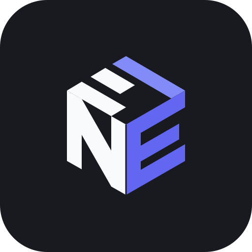

  
  <h1>NyEstudio</h1>
  
<strong>Software Engineering & Digital Product Studio</strong>

  
Arquitectura de software, desarrollo full-stack y soluciones digitales diseñadas al detalle.

---

### Qué hacemos

En **NyEstudio** combinamos ingeniería de software, diseño de interfaces y automatización para construir herramientas prácticas y productos digitales modernos:

* **Desarrollo Full-Stack & Web Apps:** Aplicaciones reactivas, paneles de gestión y APIs robustas.
* **Herramientas Operativas y Gestión:** Software orientado a optimizar procesos técnicos, flujos de trabajo y control de operaciones.
* **Arquitectura y Despliegue:** Infraestructura limpia, contenedores y automatización continua.

---

### Stack Tecnológico

* **Frontend:** React, TypeScript, Next.js, Tailwind CSS
* **Backend & Datos:** Node.js, PHP, Java, MySQL, PostgreSQL
* **Móvil & Multiplataforma:** Kotlin, Android
* **Infraestructura & Herramientas:** Docker, Linux, Git, GitHub Actions

---

### Información

* **Ubicación:** España
* **Proyectos:** En desarrollo activo

---

  El contenido de plantilla de este perfil está bajo licencia MIT. El nombre <strong>NyEstudio</strong> y su logotipo son identidad visual exclusiva de sus autores.

